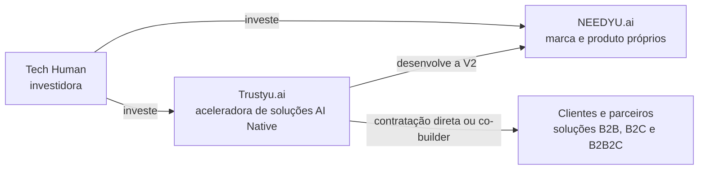

# Trustyu.ai · Tech Human · NEEDYU.ai

## Soluções AI Native para problemas reais de empresas.

**Trustyu.ai é uma aceleradora de soluções AI Native, investida pela Tech Human.**
Profissionais experientes, inteligência artificial e uma plataforma própria para descobrir o problema que vale resolver, avaliar o que já existe e construir ou modernizar o que precisa existir.

---

## O ecossistema

- **Tech Human** é investidora da Trustyu.ai e da NEEDYU.ai, com atuação própria em estratégia, negócios e transformação organizacional.
- **Trustyu.ai** acelera soluções AI Native para empresas. Atua por **contratação direta**, quando entrega uma solução ao cliente, ou como **co-builder**, quando constrói junto com um parceiro que traz domínio e distribuição, com papéis e eventual participação definidos em contrato.
- **NEEDYU.ai** tem marca e produto próprios. A V2 está em desenvolvimento através da Trustyu, em preparação para lançamento, para lembrar o que importa, recuperar contexto e ajudar a decidir, agir e resolver.

B2B define quem contrata a Trustyu; as soluções criadas podem servir operações B2B, consumidores B2C ou mercados B2B2C. Software é parte da resposta, ao lado de processo, dados, integrações, adoção e operação.

## Quatro capacidades, nenhuma sequência obrigatória

| Capacidade | Para que serve | O que você recebe | Próximo passo |
|---|---|---|---|
| **Trustyu Lens** | Descobrir o problema que vale resolver e escolher o próximo teste | Decisão de solução com evidências, hipóteses e plano de validação | [Entenda o problema →](https://www.trustyu.ai/lens) |
| **Trustyu Score** | Avaliar legados e sistemas construídos com IA | Diagnóstico técnico, com leitura de produto e negócio no nível Completo, riscos e caminhos de evolução | [Avalie seu sistema →](https://www.trustyu.ai/score) |
| **Trustyu Forge** | Conduzir engenharia com IA sob controles e evidência | Framework e harness: contexto, arquitetura, controles, revisão e rastreabilidade | [Conheça o framework →](https://forge.trustyu.ai) |
| **Trustyu AI Works** | Compor, reutilizar, modernizar e executar soluções | Plataforma de execução e reuso, dentro das capacidades já qualificadas | [Converse sobre sua solução →](https://www.trustyu.ai/get-started) |

Lens e Score têm valor isolado. Uma boa decisão pode recomendar ajustar um processo, integrar ou comprar uma ferramenta, construir, modernizar aos poucos ou não construir. Cada capacidade segue o seu próprio contrato e estágio.

O **Score** é oferecido em dois níveis, **Laudo** e **Completo**, e em três cadências: **Avulso**, **Evolução** e **Ciclo Anual**. Pacote, entregas e prazos são definidos na qualificação e no instrumento de cada avaliação.

## Onde cada frente está

Estágio aqui é evidência delimitada. Ele não decorre de estratégia aprovada, de landing publicada nem da existência de um repositório.

| Frente | Estágio | O que isso não significa |
|---|---|---|
| **Lens** | Descoberta profissional assistida por IA | Avaliação autônoma de mercado; validação externa e execução têm aceite próprio |
| **Score** | Serviço profissional assistido, com revisão humana | Portal ou avaliação autônoma disponíveis; runtime e portal seguem gates próprios |
| **Forge** | FORGE 3.3 Alpha; adoção externa sob qualificação | Equivalência entre documentação e operação; versão, canal e adoção são estados distintos |
| **AI Works** | Em desenvolvimento, com capacidades qualificadas por recurso e jornada | Disponibilidade geral, compra self-service ou clientes externos em operação |
| **NEEDYU V2** | Desenvolvimento pré-lançamento | Lançamento concluído ou disponibilidade geral |
| **CRM de Imigração** | Solução vertical entregue sob contrato | Produto de prateleira; uso e operação seguem o contrato de cada entrega |
| **Hub Agents** | Capacidade técnica com runtime em recortes específicos | Integração universal entre os produtos do ecossistema |
| **[YES b2b](https://yesb2b.trustyu.ai)** | Descoberta: plataforma de abastecimento B2B para o varejo independente | Catálogo real, checkout, oferta financeira ou parceiros contratados |
| **[Incenty AI](https://incenty.trustyu.ai)** | Pré-código: gestão auditável de programas de incentivo | SaaS em operação, contrato ou parceria; o site é pré-contratual |
| **Process Intelligence** | Definição de POC para entender e documentar processos | Execução, capacidade de produção ou integração ao AI Works |

A NEEDYU V1 pertence ao histórico: o runtime foi encerrado e a landing, preservada. Saúde, jurídico, seguros, imobiliário e construção continuam áreas de tese enquanto não houver produto e uso demonstrados.

## Engenharia e confiança

Profissionais definem intenção, arquitetura, trade-offs e critérios de aceite. Agentes de IA atuam dentro de escopo, ferramentas e ambientes autorizados. Testes, revisão humana, rastreabilidade e recuperação sustentam o que pode ser entregue — e o que pode ser afirmado.

O [site do Forge](https://forge.trustyu.ai) publica o [benchmark](https://forge.trustyu.ai/benchmark/), os registros de qualificação e as evidências, cada um com seus limites. Teste, merge, publicação, uso e resultado de negócio são verificações diferentes; uma não substitui a outra.

Reaproveitamento, automação e engenharia com IA buscam reduzir o custo total da entrega. Comparações econômicas específicas só aparecem com fonte, período, baseline e método. Recursos reutilizáveis precisam de origem, direitos, versão e manutenção; dados e materiais de clientes seguem autorização, minimização e retenção, e não viram patrimônio reutilizável por padrão.

## Por onde começar

| Situação | Próximo passo |
|---|---|
| Uma oportunidade ou dor precisa virar uma solução | [Trustyu Lens](https://www.trustyu.ai/lens) |
| Um legado ou sistema construído com IA precisa evoluir | [Trustyu Score](https://www.trustyu.ai/score) |
| O escopo de construção ou modernização já está claro | [Converse com a Trustyu](https://www.trustyu.ai/get-started) |
| Uma equipe quer adotar engenharia com IA com controles | [Trustyu Forge](https://forge.trustyu.ai) |
| O desafio principal é estratégia, pessoas e transformação | [Tech Human](https://www.techhuman.com.br) |
| Informação dispersa precisa de continuidade de contexto | [Acompanhe a NEEDYU](https://needyu.ai) |

## Neste GitHub

Os repositórios da organização são privados: guardam ativos próprios, integrações e contexto de clientes. O que é público está neste [repositório da organização](https://github.com/needyuai/.github), que define os padrões de comunidade herdados por todos os outros. A forma como trabalhamos a engenharia está publicada no [site do Forge](https://forge.trustyu.ai).

Antes de contribuir, leia o [guia de contribuição](https://github.com/needyuai/.github/blob/main/CONTRIBUTING.md) e o [Código de Conduta](https://github.com/needyuai/.github/blob/main/CODE_OF_CONDUCT.md). Vulnerabilidades seguem a [Política de Segurança](https://github.com/needyuai/.github/security/policy), nunca issues públicas.

---

**Pessoa no centro · Excelência com simplicidade · Alianças justas · Stewardship · Liderança servidora · Generosidade e give back**

[Converse sobre o problema que você precisa resolver →](https://www.trustyu.ai/get-started)

Contato: [contact@trustyu.ai](mailto:contact@trustyu.ai) · Segurança: [security@trustyu.ai](mailto:security@trustyu.ai) · Founder: [Fernando Parreiras](https://fernandoparreiras.com.br)

<!-- Alinhamento institucional: 2026-10-30, a partir do catálogo de produtos e do registro de claims 2026-10.2 e da decisão de marca YES b2b de 2026-10-19. Estágios seguem a qualificação de cada produto; revisar quando estágio, oferta ou canal mudar. -->
